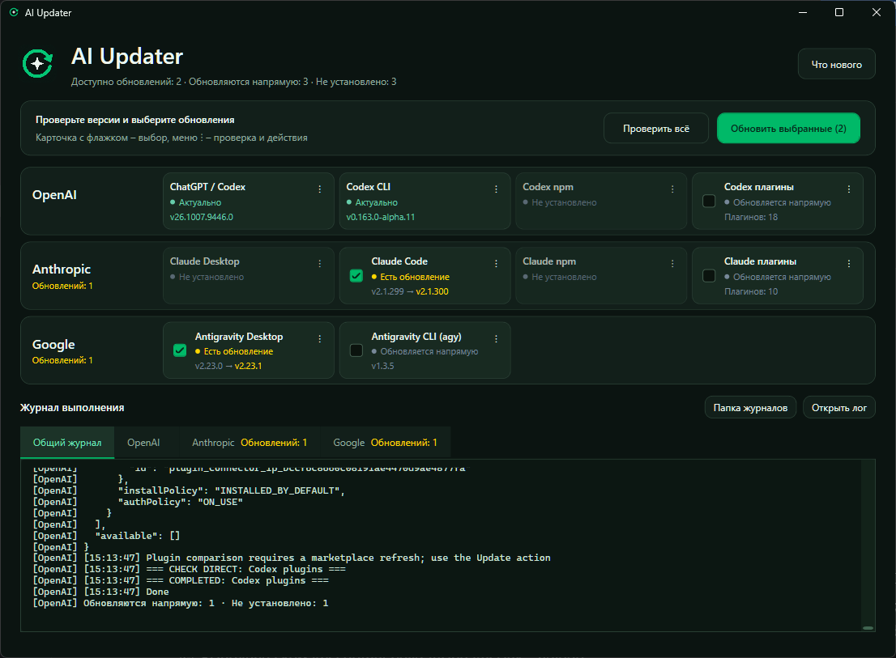

# AIUpdater

### Codex обновился, Claude отстал, а плагины вообще живут своей жизнью?

[](https://github.com/TheVSAKeeper/AIUpdater/actions/workflows/ci.yml)
[](https://github.com/TheVSAKeeper/AIUpdater/actions/workflows/release.yml)


---

## Что это

У каждого AI-инструмента свой способ обновления: один сидит в Microsoft Store, другой в npm, третий
притащил собственный установщик. Пока обойдёшь всех по очереди, забудешь, с кого начал.

AIUpdater собирает инструменты OpenAI, Anthropic и Google в одном окне. Показывает установленные
и доступные версии, проверяет обновления и ставит выбранное. У каждого компонента своя карточка,
у каждого провайдера свой журнал – если один споткнулся, результат другого не потеряется.

C#, WPF, .NET 10. Только Windows, тёмная тема, без путешествий по десяти терминалам.

Готовые сборки – в [GitHub Releases](https://github.com/TheVSAKeeper/AIUpdater/releases/latest):
обычный ZIP требует .NET 10 Desktop Runtime, автономный ZIP уже содержит рантайм.

---

## Скриншот



---

## Что обновляет

| Провайдер | Компоненты                                                                             |
|-----------|----------------------------------------------------------------------------------------|
| OpenAI    | ChatGPT / Codex desktop, активный Codex CLI, глобальный npm-пакет Codex, плагины Codex |
| Anthropic | Claude Desktop, Claude Code, глобальный npm-пакет Claude Code, плагины Claude          |
| Google    | Antigravity Desktop, Antigravity CLI (`agy`)                                           |

Активный CLI и npm-пакет вынесены отдельно: команда из `PATH` может вести совсем не туда, куда npm
ставит глобальные пакеты. Обновляешь тот компонент, которым пользуешься.

---

## Как пользоваться

1. Нажми **«Проверить всё»**. Приложение соберёт версии и отметит компоненты с доступным обновлением.
2. Посмотри карточки и сними лишние галочки. Для плагинов и `agy` сравнение версий недоступно:
   их нужно выбрать самому, если карточка предлагает прямое обновление.
3. Нажми **«Обновить выбранные»**. Ход работы виден в общем журнале и во вкладках провайдеров.

Кнопка **⋮** на карточке открывает проверку, обновление, установку, удаление и **«Что нового»**.
Установка и удаление выполняются для одного компонента; перед удалением приложение переспросит.
Для карточек плагинов установка и удаление недоступны.

<details>
<summary>Что означают результаты и где искать журнал</summary>

Карточка различает актуальную версию, доступное обновление, отсутствие программы, прямое обновление
и ошибку проверки. Если версию узнать не удалось, это не превращается в «всё обновлено».
Причина и время последней проверки доступны в подсказке.

Последние результаты сохраняются между запусками. После открытия окна это история, а свежие данные
появятся после новой проверки.

Журналы и `LastResults.json` лежат в `%LOCALAPPDATA%\AIUpdater\Logs`. Кнопки **«Открыть лог»**
и **«Папка журналов»** ведут к ним прямо из окна.

</details>

---

## Структура проекта

```text
src/AIUpdater/                 приложение WPF
    Models/                   состояния компонентов и данные
    Views/                    окна и диалоги
    Services/                 загрузка истории изменений
    Infrastructure/           интеграция с Windows
    Assets/                   иконка и изображения
    Scripts/                  проверка, обновление, установка и удаление
tests/AIUpdater.InterfaceChecks/ проверки интерфейса
tests/Scripts/                проверки PowerShell-логики
build/                        проверки, сборка, упаковка релизов и генерация иконки
```

В `AIUpdater.slnx` включены приложение и проект проверок интерфейса.
При сборке и публикации рабочие PowerShell-скрипты копируются рядом с exe.

---

## Запуск из исходников

Нужны Windows и .NET 10 SDK. Для операций с desktop-приложениями используется `winget`, для глобальных
npm-пакетов – Node.js с npm. Проверки и обновления приложение запускает через Windows PowerShell.
Само окно запрашивает права администратора при старте.

```powershell
dotnet run --project src/AIUpdater/AIUpdater.csproj
```

Собрать готовую папку для запуска:

```powershell
dotnet publish src/AIUpdater/AIUpdater.csproj -c Release --self-contained false -o publish/local
```

Открой `publish/local/AIUpdater.exe`. Для такой сборки нужен .NET 10 Desktop Runtime;
три PowerShell-скрипта рядом с exe тоже нужны, отдельно файл не уноси.

<details>
<summary>Сборка с ярлыком на рабочем столе</summary>

Из PowerShell 7:

```powershell
pwsh -NoProfile -ExecutionPolicy Bypass -File build/publish-local.ps1
```

Скрипт собирает приложение в новую папку внутри `publish`, создаёт ярлык `AIUpdater.lnk`
и команду **«Обновить AIUpdater.cmd»** на рабочем столе. Команда пересобирает приложение из этого
репозитория. Старые файлы прежней установки с рабочего стола переезжают в `artifacts/desktop-previous`.

</details>

---

## Проверки

Весь набор проверок одной командой из PowerShell 7:

```powershell
pwsh -NoProfile -ExecutionPolicy Bypass -File build/verify.ps1
```

Или по отдельности:

```powershell
dotnet build AIUpdater.slnx
powershell -NoProfile -ExecutionPolicy Bypass -File tests/Scripts/Verify-Updater.ps1
powershell -NoProfile -ExecutionPolicy Bypass -File tests/Scripts/Verify-PackageChecks.ps1
pwsh -NoProfile -ExecutionPolicy Bypass -File tests/Scripts/Verify-Release.ps1
dotnet run --project tests/AIUpdater.InterfaceChecks -- artifacts/interface-check
```

Скрипты проверяют сценарии обновления и чтение версий на подставных ответах команд.
Проверка WPF-интерфейса тоже использует имитацию: установленные программы не меняет,
снимки окна сохраняет в `artifacts/interface-check`.

---

## Релизы

Номер хранится в `Directory.Build.props`: `1`, `2` и далее, для исправлений – `1.1`, `1.2`.
В заголовке окна и тегах он отображается с `v`: `v1`, `v1.1`.
Обе части номера положительные, без ведущих нулей, до 65534 – предел метаданных сборки Windows.
SDK для сборки указан в `global.json`.

Сначала опиши изменения для пользователя в [CHANGELOG.md](CHANGELOG.md), под заголовком будущей
версии, например `## 2` или `## 1.1`. Затем повысь номер:

```powershell
pwsh -NoProfile -ExecutionPolicy Bypass -File build/bump-version.ps1
pwsh -NoProfile -ExecutionPolicy Bypass -File build/bump-version.ps1 -Version patch
```

Это две альтернативные команды: первая переводит `1` или `1.2` в `2`, вторая – `1` в `1.1`,
а `1.1` в `1.2`. Можно указать точный следующий номер через `-Version 3` или `-Version 2.1`.
Повтор и понижение номера запрещены. Без непустого раздела изменений номер не меняется.
Скрипт сам не создаёт коммит и не отправляет изменения на GitHub.

После коммита и push в `master` workflow `CI` собирает решение и запускает проверки.
Успешный CI запускает `Release` для того же коммита. Если такого релиза ещё нет, он собирает
архивы, создаёт тег и GitHub Release с заметками из CHANGELOG и техническим списком изменений.
Ручной запуск `Release` на `master` повторно выполняет проверки. Уже опубликованный номер пропускается.

| Файл релиза | Что внутри |
|-------------|------------|
| `AIUpdater-v1-win-x64.zip` | Приложение и скрипты; нужен .NET 10 Desktop Runtime |
| `AIUpdater-v1-win-x64-portable.zip` | Приложение, скрипты и рантайм |
| `SHA256SUMS.txt` | Контрольные суммы обоих архивов |

В именах файлов `v1` заменяется текущим номером. Распаковывай архив целиком: скрипты нужны рядом с exe.
Оба варианта хранят журналы и результаты в `%LOCALAPPDATA%\AIUpdater\Logs`.

Для локальной сборки тех же архивов:

```powershell
pwsh -NoProfile -ExecutionPolicy Bypass -File build/package-release.ps1
```

Скрипт печатает путь к новой папке внутри `artifacts/release`. Там находятся оба ZIP, контрольные суммы
и описание релиза. Локальная упаковка ничего не публикует.

---

## Чего не умеет

- Linux и macOS – приложение работает только на Windows.
- Обновляться по расписанию – проверку и установку запускаешь сам.
- Сравнивать версии плагинов и `agy` перед обновлением – для них есть прямой запуск обновления.

*Все обновлялки в одном окне. Можно наконец закрыть лишние терминалы.*
