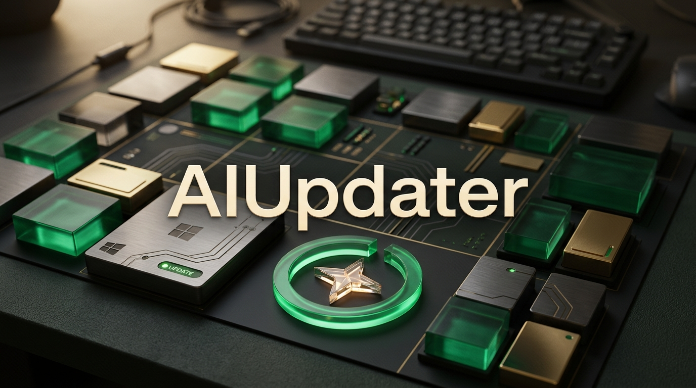
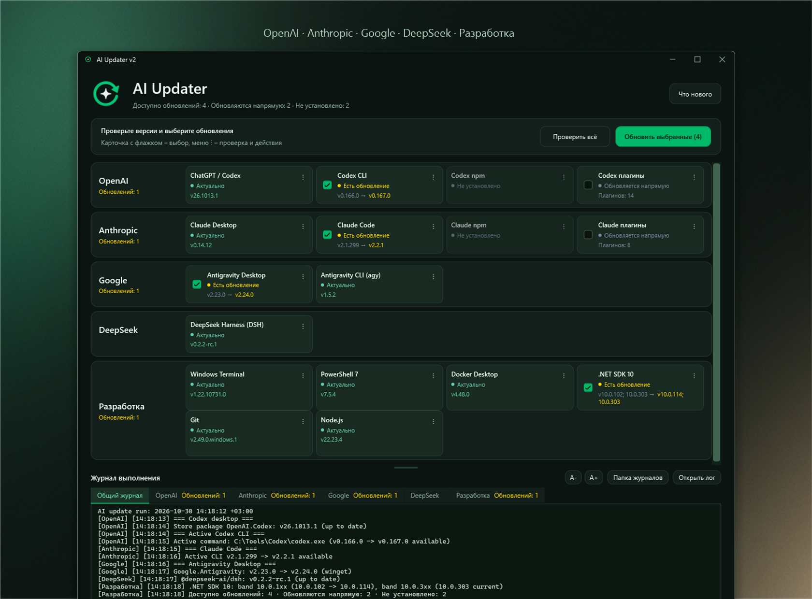
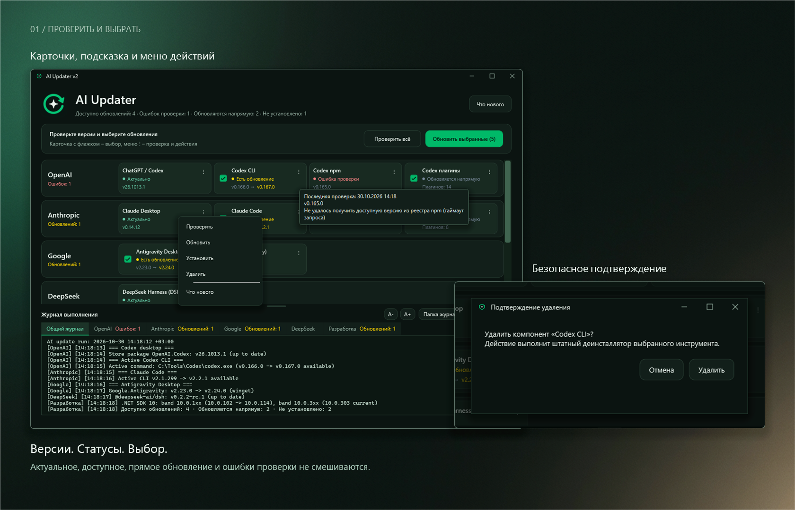
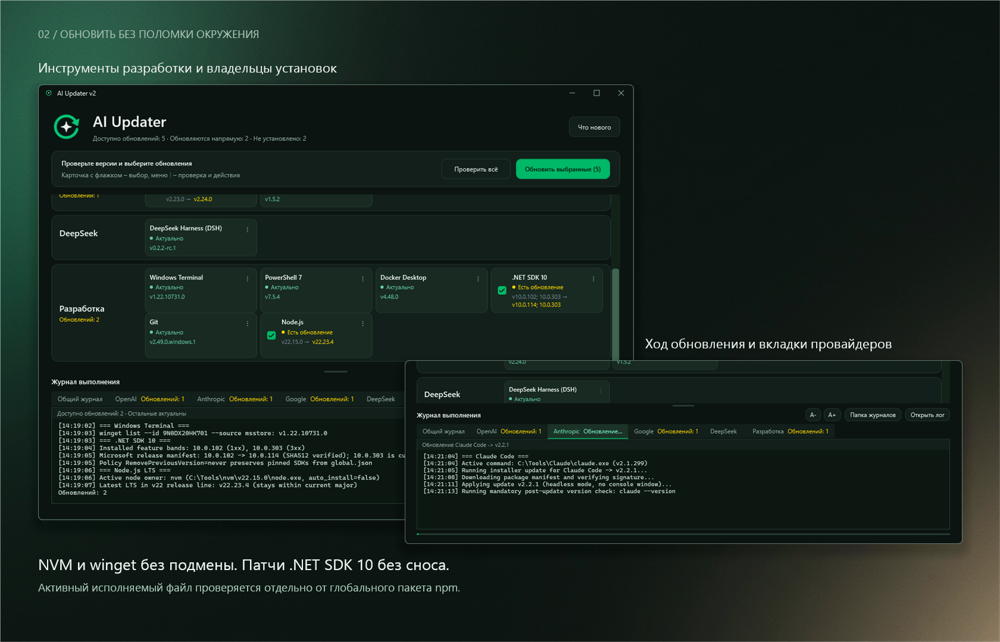
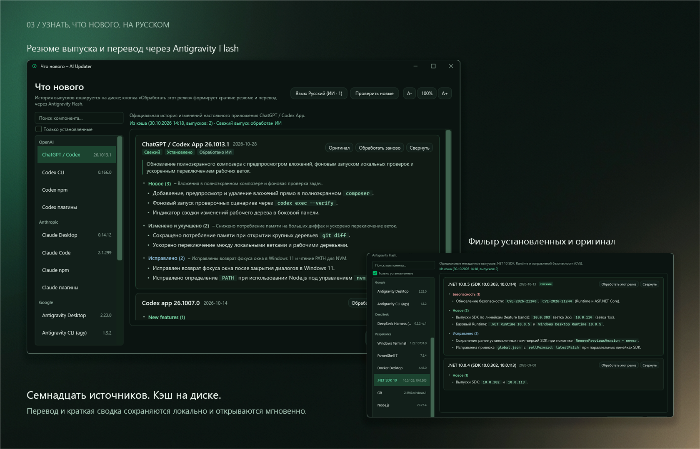

# AIUpdater



### Codex обновился, Claude отстал, а плагины вообще живут своей жизнью?

У каждого AI-инструмента свой способ обновления: один сидит в Microsoft Store, другой в npm, третий
притащил собственный установщик, а рядом ещё живут терминал, PowerShell, Node и .NET SDK. Пока обойдёшь
всех по очереди в разных консолях, забудешь, с кого начал и какую копию в `PATH` на самом деле обновил.

AIUpdater собирает инструменты OpenAI, Anthropic, Google, DeepSeek и окружение разработки в одном окне.
Показывает установленные и доступные версии, проверяет обновления и ставит выбранное. У каждого компонента
своя карточка, у каждого провайдера свой журнал – если один споткнулся, результат другого не потеряется.
Бонусом – окно «Что нового» с историей релизов всех 17 инструментов, локальным кэшем и переводом через ИИ.

[](https://github.com/TheVSAKeeper/AIUpdater/actions/workflows/ci.yml)
[](https://github.com/TheVSAKeeper/AIUpdater/actions/workflows/release.yml)


**[Скачать для Windows](https://github.com/TheVSAKeeper/AIUpdater/releases/latest)** · [Начать работу](#начать-работу) · [Руководство](GUIDE.md) · [Все скриншоты](assets/screenshots/README.md)



*Семнадцать карточек в пяти группах и отдельные вкладки журналов по провайдерам. Композиция собрана из настоящих снимков; [все экраны отдельно](assets/screenshots/README.md).*

## Проверить всё в одном окне

Нажимаешь **«Проверить всё»** – приложение опрашивает магазины, реестры и манифесты, сравнивает версии
и ставит галочки только там, где действительно вышло обновление. Сбой сети или таймаут не маскируется под
«всё актуально»: такая карточка честно покажет ошибку проверки и причину в подсказке при наведении.



Для плагинов Codex и Claude предварительное сравнение версий недоступно – они помечаются как **«Обновляется напрямую»**,
и ты сам решаешь, когда ставить галочку. Кнопка `⋮` на любой карточке открывает точечную проверку, обновление,
установку, удаление с подтверждением и переход к списку изменений именно этого инструмента.

[Провайдеры, карточки и статусы →](GUIDE.md#провайдеры-и-карточки)

## Обновить без поломки окружения

Команда `codex` или `claude` из `PATH` часто ведёт совсем не туда, куда `npm` ставит глобальные пакеты.
Поэтому активный CLI и глобальный npm-пакет разведены по разным карточкам – сразу видно, чем ты реально
пользуешься и какая копия отстала.



- **Node.js**: определяет владельца активной команды (`nvm` или `winget`), обновляет в пределах текущей major-ветки и блокирует `winget`, если Node управляется через NVM. В shim-режиме NVM требует выключенного `auto_install`, чтобы простая проверка версии не качала Node втайне.
- **.NET SDK 10**: ставит патчи только для уже установленных линеек (`10.0.1xx`, `10.0.3xx` и др.) по подписанным установщикам Microsoft с проверкой `SHA512`. На время установки включает `RemovePreviousVersion = never`, чтобы закреплённые в `global.json` SDK никуда не пропали.
- **Терминал и оболочка**: обновляет Windows Terminal через источник `msstore`, а при нескольких `pwsh` в `PATH` предупреждает о конфликте, не затирая `.NET global tool` пакетом из `winget`.

[Механизмы обновления и защита окружения →](GUIDE.md#инструменты-разработки-и-защита-окружения)

## Узнать, что нового, на русском

Перед обновлением хочется понять, что вообще поменялось, не открывая полтора десятка вкладок на GitHub и в npm.
Окно **«Что нового»** собирает заметки о выпусках по всем 17 компонентам, хранит их на диске и открывается мгновенно,
а свежие релизы подтягивает по кнопке **«Проверить новые»**.



Нажми **«Обработать этот релиз»** – локальный `Antigravity CLI (agy)` на быстрой модели Flash переведёт выпуск на русский
и разложит изменения по полочкам: *Новое*, *Изменено и улучшено*, *Исправлено*, *Безопасность*. Перевод кэшируется
на диске, а переключатель **«Оригинал / Перевод»** в один клик возвращает исходный английский текст.

[Источники релизов, кэш и ИИ-обработка →](GUIDE.md#история-изменений-и-перевод)

## Начать работу

1. Скачай свежий архив из [GitHub Releases](https://github.com/TheVSAKeeper/AIUpdater/releases/latest) и распакуй целиком: `AIUpdater-v2-win-x64-portable.zip` уже содержит рантайм, а обычному `AIUpdater-v2-win-x64.zip` нужен [.NET 10 Desktop Runtime](https://dotnet.microsoft.com/download/dotnet/10.0).
2. Запусти `AIUpdater.exe` (приложение запросит права администратора) и нажми **«Проверить всё»**. Доступные обновления отметятся автоматически.
3. Проверь галочки, при необходимости добавь плагины и нажми **«Обновить выбранные»**. Ход выполнения виден в общем журнале и во вкладках провайдеров.

Результаты прошлой проверки и логи лежат в `%LOCALAPPDATA%\AIUpdater\Logs`, кэш заметок о релизах и переводы –
в `%LOCALAPPDATA%\AIUpdater\Changelogs`. Размер шрифта в журнале и масштаб окна «Что нового» меняются кнопками
`A-` / `A+` или `Ctrl + колесо мыши` и сохраняются между запусками.

## Как обновляются компоненты

| Группа | Компоненты | Как проверяется и обновляется |
| --- | --- | --- |
| OpenAI | ChatGPT / Codex, Codex CLI, Codex npm, Codex плагины | Store / `winget`, активный CLI в `PATH`, глобальный npm и прямое обновление плагинов |
| Anthropic | Claude Desktop, Claude Code, Claude npm, Claude плагины | `winget`, штатный установщик активного CLI, глобальный npm и `claude plugin update` |
| Google | Antigravity Desktop, Antigravity CLI (`agy`) | `winget` и манифест официального установщика `agy` для Windows x64 / ARM64 |
| DeepSeek | DeepSeek Harness (`DSH`) | Глобальный пакет `@deepseek-ai/dsh` в канале `latest` (включая RC-выпуски) |
| Разработка | Windows Terminal, PowerShell 7, Docker Desktop, .NET SDK 10, Git, Node.js | `msstore`, `winget`, патчи линеек `.NET SDK 10` по манифесту Microsoft и владелец Node (`nvm` / `winget`) |

Приложение работает только на Windows, не висит в фоне и ничего не обновляет по расписанию без твоего ведома.
[Подробные правила и частые вопросы →](GUIDE.md#частые-вопросы)

## Собрать из исходников

Нужны Windows и .NET SDK **10.0.303**, закреплённый в `global.json`.

```powershell
dotnet run --project src/AIUpdater/AIUpdater.csproj
```

Полный прогон автоматических проверок (сборка, PowerShell-тесты на подставных ответах и проверка WPF-интерфейса):

```powershell
pwsh -NoProfile -ExecutionPolicy Bypass -File build/verify.ps1
```

Локальная упаковка релизных архивов в `artifacts/release`: `pwsh -NoProfile -ExecutionPolicy Bypass -File build/package-release.ps1`.

---

[Что нового](CHANGELOG.md) · [Подробное руководство](GUIDE.md) · [Галерея всех экранов](assets/screenshots/README.md) · [Сообщить о проблеме](https://github.com/TheVSAKeeper/AIUpdater/issues)

*Все обновлялки в одном окне. Можно наконец закрыть лишние терминалы.*
