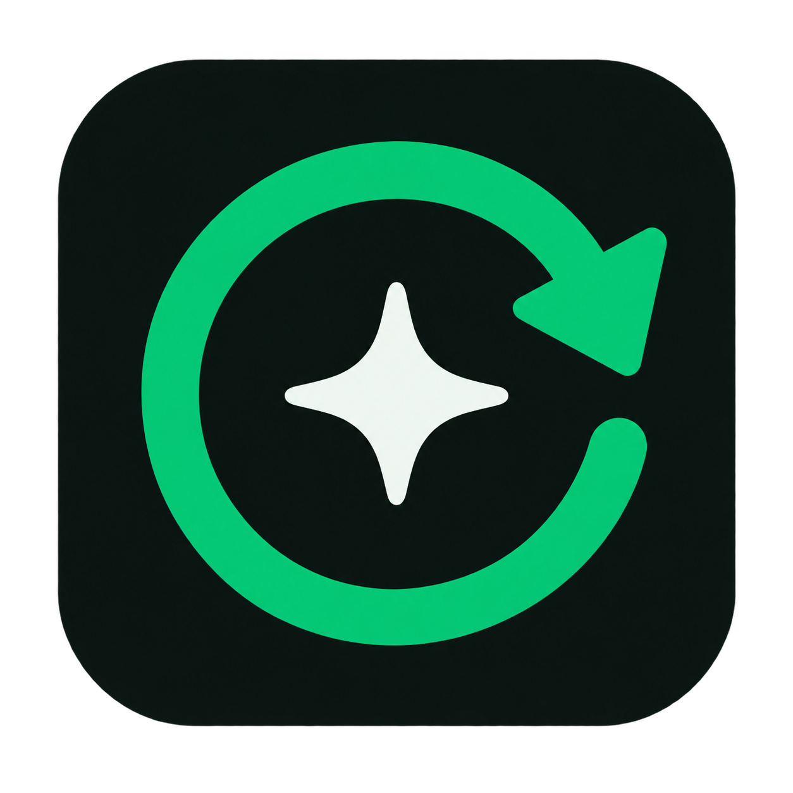
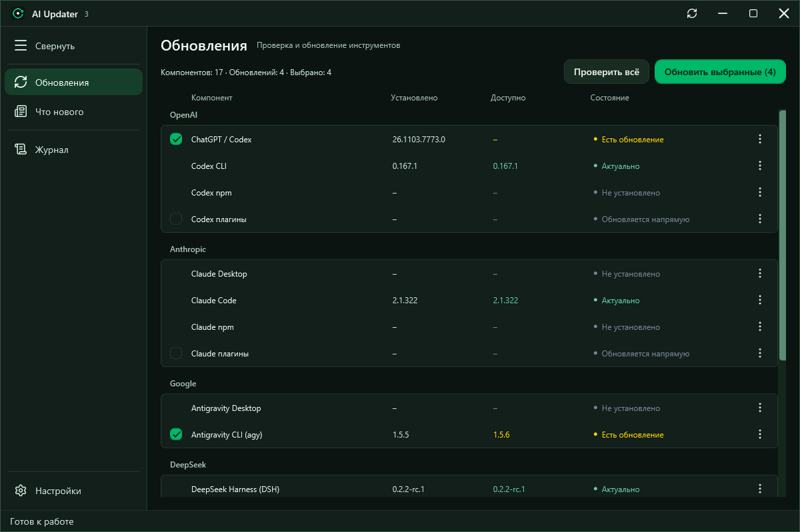
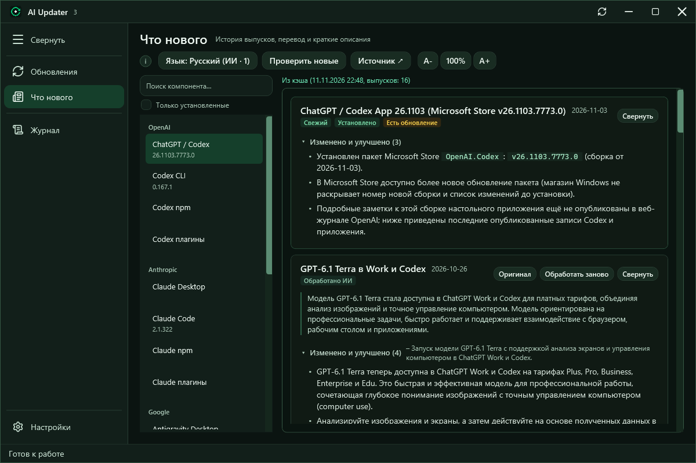

<p align="center">
  
</p>

<h1 align="center">AIUpdater</h1>

<p align="center">AI-инструменты и окружение разработки в одном окне Windows</p>

<p align="center">
  <a href="https://github.com/TheVSAKeeper/AIUpdater/releases/latest"></a>
  <a href="https://github.com/TheVSAKeeper/AIUpdater/actions/workflows/ci.yml"></a>
  
  
  
  <a href="LICENSE"></a>
</p>

<p align="center">
  <a href="https://github.com/TheVSAKeeper/AIUpdater/releases/latest"><strong>Скачать для Windows</strong></a> ·
  <a href="GUIDE.md">Руководство</a> ·
  <a href="assets/screenshots/README.md">Скриншоты</a> ·
  <a href="CHANGELOG.md">Что нового</a>
</p>

AIUpdater проверяет и обновляет 17 компонентов OpenAI, Anthropic, Google, DeepSeek и окружения разработки.
Видно, какая версия установлена, что доступно и какой шаг выполняется сейчас. Обновления выбираешь сам;
ошибка одного компонента не стирает результаты остальных.



## Что умеет

- **Проверять версии** из Microsoft Store, `winget`, npm, официальных манифестов и установленных CLI. Активная команда в `PATH` и глобальный npm-пакет показаны отдельно.
- **Следить за выполнением**: текущие шаги, проценты загрузки, завершённые задачи и очередь. Фильтр «Только в работе» собирает активные задачи всех групп; остановка доступна из любого раздела.
- **Показывать историю выпусков** с локальным кэшем, поиском, фильтром установленных компонентов, оригиналом и русским резюме.
- **Переводить выбранным агентом**: Antigravity, Claude Code, Codex или OpenCode. CLI, модель, уровень рассуждения и путь задаются в «Настройки → Перевод».
- **Сохранять контекст**: переходы между обновлениями, историей, журналом и настройками не прерывают операцию и не теряют черновики. Масштаб интерфейса и вид панели навигации настраиваются отдельно.

## Скачать и запустить

Открой [последний релиз](https://github.com/TheVSAKeeper/AIUpdater/releases/latest) и выбери архив:

| Архив | Что нужно |
| --- | --- |
| `AIUpdater-v…-win-x64-portable.zip` | Рантайм уже включён |
| `AIUpdater-v…-win-x64.zip` | Установленный [.NET 10 Desktop Runtime](https://dotnet.microsoft.com/download/dotnet/10.0) для Windows x64 |
| `SHA256SUMS.txt` | Контрольные суммы обоих архивов |

1. Распакуй архив целиком. Три PowerShell-скрипта должны оставаться рядом с `AIUpdater.exe`.
2. Запусти `AIUpdater.exe`. Приложение запрашивает права администратора при запуске.
3. Нажми **«Проверить всё»**, проверь выбранные компоненты и нажми **«Обновить выбранные»**.

Обычная проверка не устанавливает отсутствующие программы. Для точечного действия используй меню `⋮`
в строке компонента: проверка, обновление, установка, удаление с подтверждением или история выпусков.

Для ИИ-обработки отдельно установи и авторизуй выбранный CLI. Без него доступны проверки обновлений,
история и оригинальные заметки. Приложение не требует отдельного API-ключа: используется конфигурация CLI.

Данные хранятся в `%LOCALAPPDATA%\AIUpdater`. Приложение ничего не обновляет по расписанию.
[Первые шаги и частые вопросы →](GUIDE.md#частые-вопросы)

## Какие компоненты поддерживаются

| Группа | Компоненты |
| --- | --- |
| OpenAI | ChatGPT / Codex, Codex CLI, Codex npm, Codex плагины |
| Anthropic | Claude Desktop, Claude Code, Claude npm, Claude плагины |
| Google | Antigravity Desktop, Antigravity CLI (`agy`) |
| DeepSeek | DeepSeek Harness (`DSH`) |
| Разработка | Windows Terminal, PowerShell 7, Docker Desktop, .NET SDK 10, Git, Node.js |

Node.js обновляется в пределах текущей major-ветки с учётом владельца установки (`nvm` или `winget`).
Для .NET SDK обновляются уже установленные линейки с проверкой подписи и SHA512 установщика;
закреплённые SDK сохраняются. Плагины Codex и Claude обновляются напрямую и выбираются вручную.

[Механизмы обновления и защита окружения →](GUIDE.md#инструменты-разработки-и-защита-окружения)

## История изменений на русском

Выбери компонент в разделе **«Что нового»**. Сохранённые выпуски открываются из кэша, а **«Проверить новые»**
запрашивает свежие заметки у источника. Кнопка **«Обработать этот релиз»** передаёт текст выбранному агенту:
он готовит русское резюме и группирует изменения. Оригинал остаётся доступен, перевод сохраняется на диске.



Настройка агента находится в **«Настройки → Перевод»**. Параметры сохраняются отдельно для каждого CLI;
список моделей Antigravity загружается командой `agy models`, ручной ввод ID тоже поддерживается.

[Все экраны: выполнение, журналы, перевод и внешний вид →](assets/screenshots/README.md)

## Собрать из исходников

Нужны Windows и .NET SDK из [global.json](global.json). Пакеты KeepShell включены в локальный источник `packages/`;
отдельно скачивать исходники каркаса для сборки не требуется.

```powershell
dotnet restore AIUpdater.slnx --locked-mode
dotnet run --project src/AIUpdater/AIUpdater.csproj -c Release
```

Полная проверка сборки, PowerShell-сценариев и WPF-интерфейса на тестовых данных:

```powershell
pwsh -NoProfile -ExecutionPolicy Bypass -File build/verify.ps1
```

Упаковка обычного и self-contained архивов:

```powershell
pwsh -NoProfile -ExecutionPolicy Bypass -File build/package-release.ps1
```

## Участие в проекте

[Сообщить об ошибке или предложить изменение](https://github.com/TheVSAKeeper/AIUpdater/issues/new/choose) ·
[Подготовить pull request](CONTRIBUTING.md) · [Сообщить об уязвимости](SECURITY.md)

Исходный код распространяется по [лицензии MIT](LICENSE).
