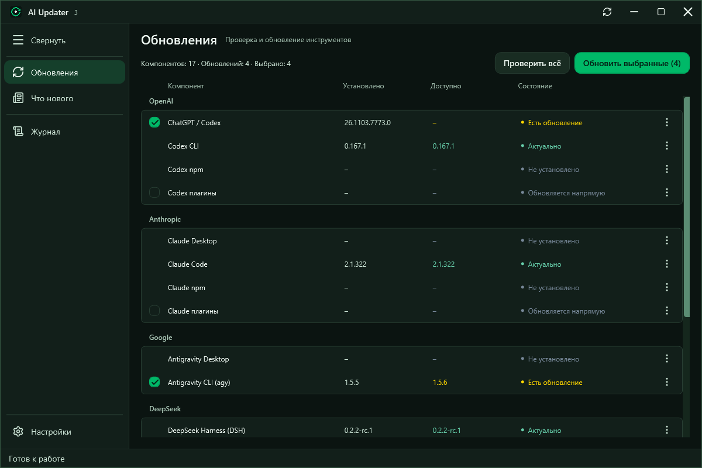
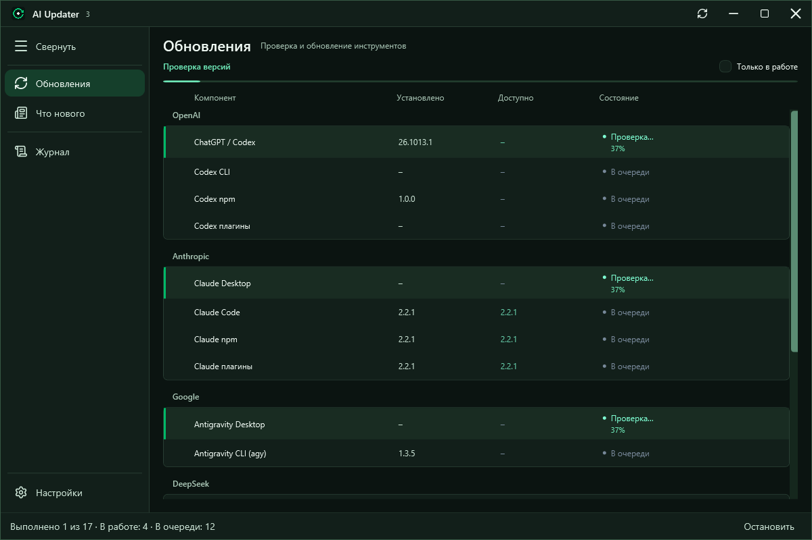
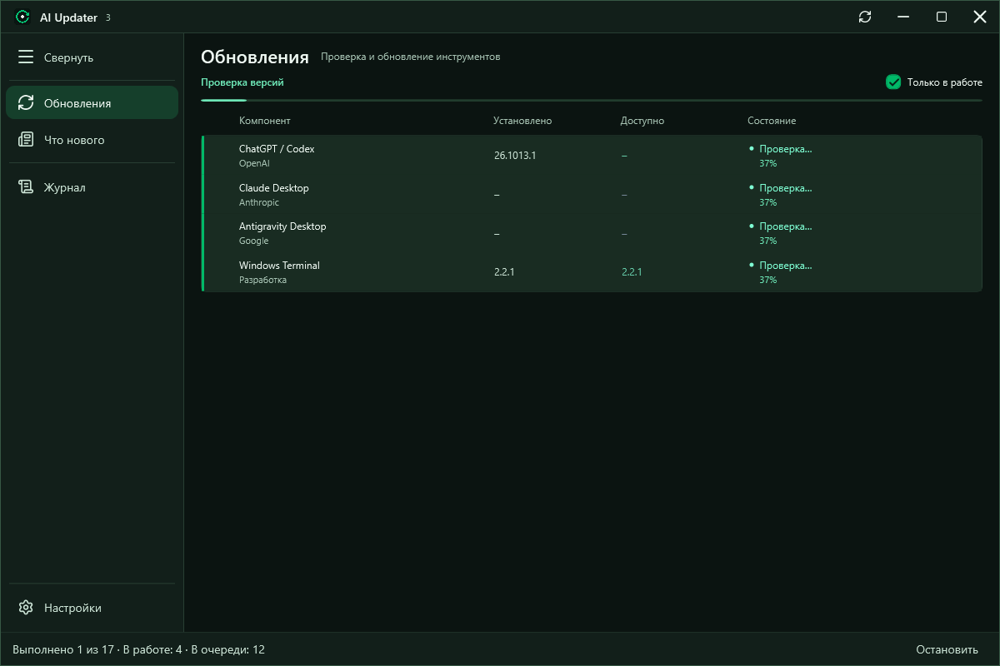
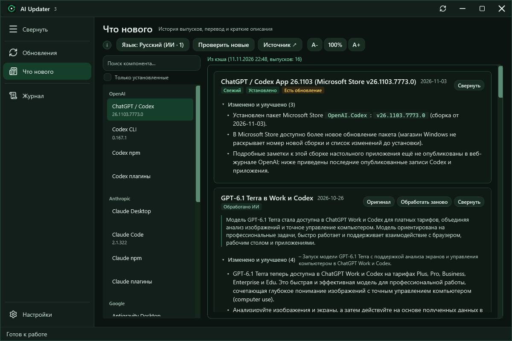
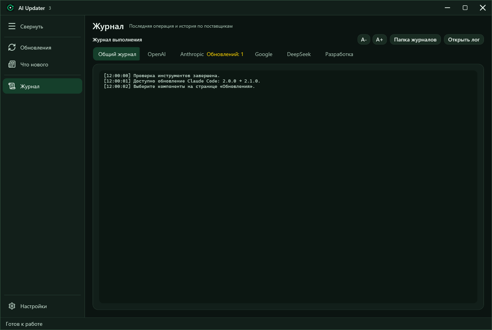
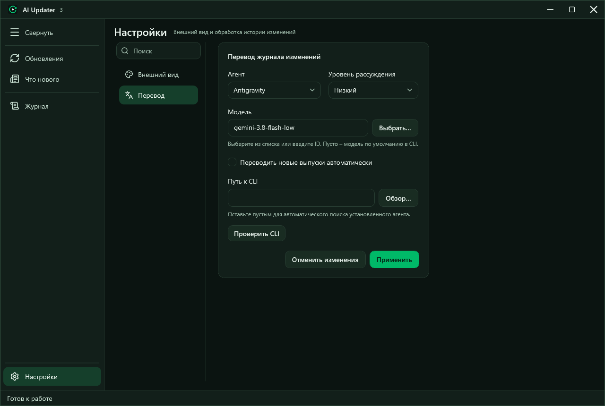
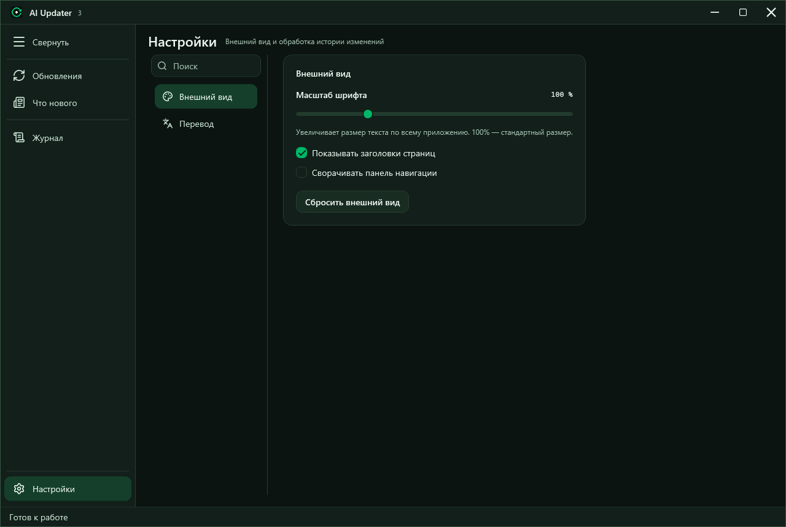
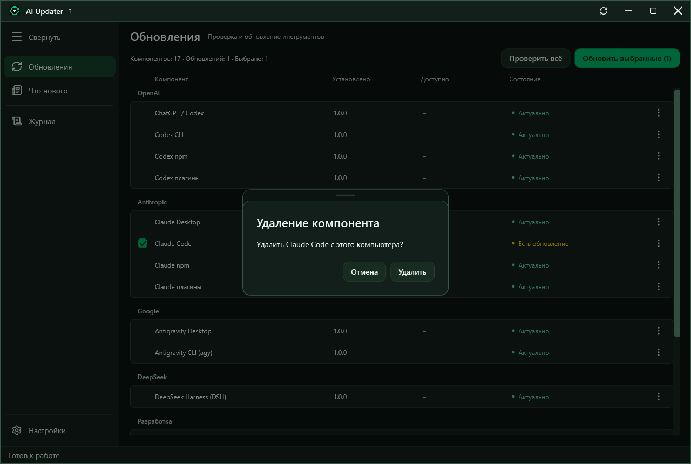

# AIUpdater v3

Актуальный интерфейс с четырьмя разделами KeepShell. Кадры получены из WPF-приложения;
для сцен выполнения используются тестовые процессы с демонстрационным выводом, без установки обновлений.

## Обновления

Установленные и доступные версии, отдельные результаты и выбор компонентов.



Текущие шаги и очередь остаются видны во время проверки. Общая строка состояния содержит остановку.



«Только в работе» показывает активные задачи всех групп вместе.



## Что нового

История выпусков, поиск по компонентам, оригинал и русское резюме. Управление агентом находится в настройках.



## Журнал

Общий вывод и вкладки провайдеров используют то же состояние операции, что и страница обновлений.



## Настройки

Выбор CLI, модели, уровня рассуждения, пути к программе и автоматической обработки.



Общий масштаб, заголовки страниц и панель навигации.



## Подтверждение удаления

Диалог открывается внутри оболочки; безопасное действие по умолчанию – отмена.



## Как обновить кадры

Галерея создаёт автономные демонстрационные данные и не запускает обновления или запросы к моделям:

```powershell
dotnet run --project src/AIUpdater/AIUpdater.csproj -c Release -- --gallery artifacts/gallery --size 1280x860
```

Результаты находятся в `artifacts/gallery`: PNG, индекс кадров и отчёт привязок `binding-errors.json`.
Сцены параллельного выполнения снимает штатная проверка `build/verify.ps1` в `artifacts/interface-check`.
Перед публикацией кадры нужно просмотреть и убрать персональные данные из журналов и путей.

[На главную](../../README.md) · [Руководство](../../GUIDE.md)
